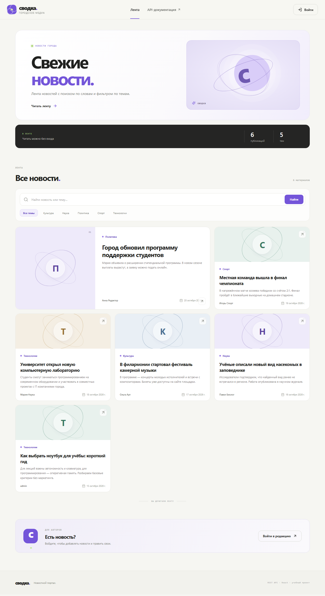
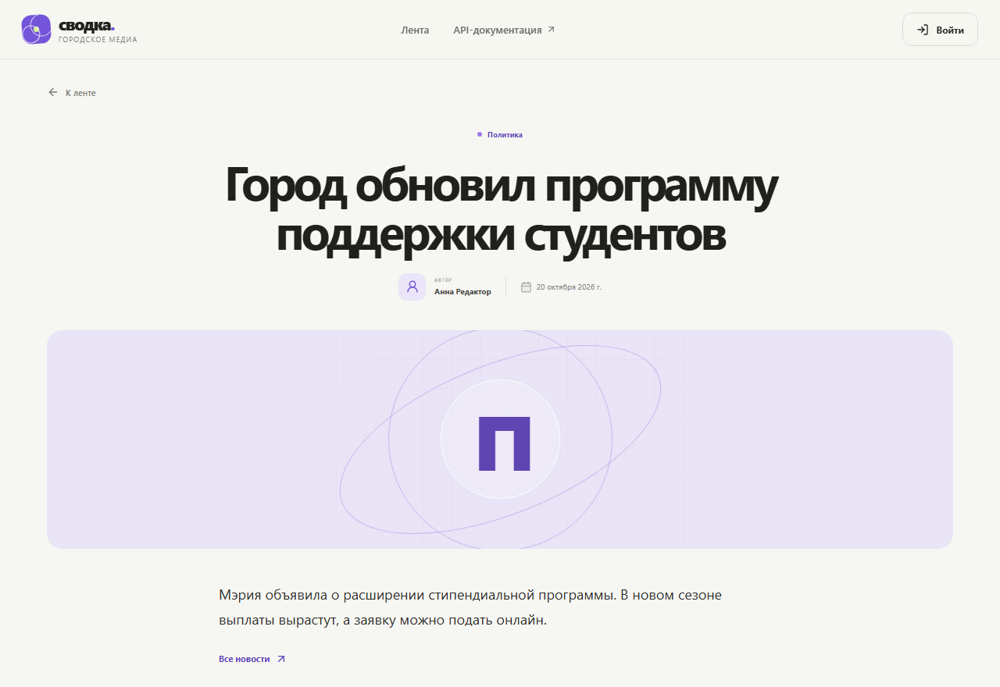
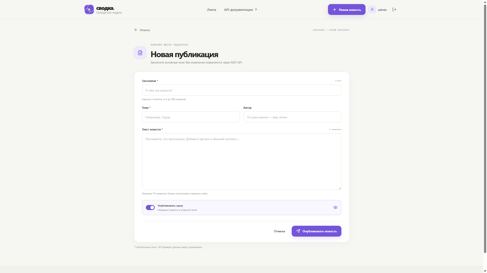

# Лабораторная работа №2. Интеграция REST API с фронтендом на React

**Тема:** новостной портал, вариант 9  
**Студент:** ______________________  
**Группа:** ______________________

## 1. Цель

Подключить React-приложение к REST API из лабораторной №1: получать новости, показывать их, создавать, изменять и удалять, а также искать и фильтровать.

## 2. Что сделано

| Требование | Как выполнено |
|---|---|
| API из лабораторной №1 | сайт ходит в тот же FastAPI |
| GET, POST, PUT, DELETE | список, создание, полная замена, удаление |
| Таблица или карточки | лента карточек |
| Добавление, правка, удаление | форма и кнопки на странице новости |
| Фильтрация или поиск | строка поиска и кнопки категорий |
| axios или fetch | `fetch` в `frontend/src/api.js` |
| CORS | в `app/main.py` разрешены `localhost:5173` и `127.0.0.1:5173`; в разработке Vite проксирует `/api` на сервер |
| Оформление | собственный интерфейс «Сводка» |
| Три экрана | лента, форма, страница новости |

Читать ленту можно без входа. Создавать новость можно после входа. Кнопки «Редактировать» и «Удалить» видны только автору записи: у новости есть `owner_id`, его сравнивают с `id` текущего пользователя.

## 3. Структура

```
frontend/
  index.html
  package.json
  vite.config.js          прокси /api → http://127.0.0.1:8000
  src/main.jsx            точка входа
  src/App.jsx             маршруты и шапка
  src/api.js              все запросы к API
  src/AuthContext.jsx     токен и текущий пользователь
  src/pages/HomePage.jsx  лента, поиск, фильтр
  src/pages/NewsDetailPage.jsx
  src/pages/NewsFormPage.jsx
  src/pages/AuthPage.jsx  вход и регистрация
  src/styles.css
docs/screenshots/         снимки интерфейса
```

Маршруты сайта:

| Адрес | Экран |
|---|---|
| `/` | лента новостей |
| `/news/:id` | одна новость |
| `/news/new` | новая новость, только после входа |
| `/news/:id/edit` | правка своей новости |
| `/login`, `/register` | вход и регистрация |

## 4. Как сайт вызывает API

Запросы идут на `/api/...`. Vite убирает префикс `/api` и передаёт их на `http://127.0.0.1:8000`.

| Действие на сайте | Запрос |
|---|---|
| Лента | `GET /news?page=1&page_size=6` |
| Поиск | `GET /news?q=финал` |
| Фильтр | `GET /news?category=Спорт` |
| Кнопки тем | `GET /categories` |
| Счётчики в шапке ленты | `GET /stats` |
| Открыть новость | `GET /news/2` |
| Войти | `POST /auth/login` (форма `username` и `password`) |
| Кто вошёл | `GET /auth/me` |
| Создать | `POST /news` |
| Сохранить правку | `PUT /news/2` |
| Удалить | `DELETE /news/2` |

После входа токен хранится в браузере и уходит заголовком `Authorization: Bearer <токен>`.

Пример тела создания:

```json
{
  "title": "Новость для отчёта",
  "content": "Достаточно длинный текст учебной новости.",
  "category": "Наука",
  "is_published": true
}
```

Если автор не указан, API подставляет логин. Чужая новость на `PUT` и `DELETE` отвечает `403`.

## 5. Скриншоты

Лента, поиск и фильтр по категориям:



Страница одной новости:



Форма добавления и редактирования:



## 6. Как запустить

Сначала API из корня проекта:

```powershell
.\.venv\Scripts\Activate.ps1
python -m uvicorn app.main:app --reload
```

Затем сайт:

```powershell
cd frontend
npm install
npm run dev
```

Открыть http://127.0.0.1:5173. Демо-аккаунт: `admin` / `admin123`. Учебные новости принадлежат `admin`, поэтому править их может только он. Новый пользователь после регистрации создаёт и меняет свои записи.

Проверка:

1. Без входа открывается лента, поиск `финал` и тема «Спорт» сужают список.
2. Карточка открывает страницу новости. Кнопок правки нет.
3. Войти как `admin`. В ленте появляется его черновик, на своих новостях — кнопки «Редактировать» и «Удалить».
4. «Новая новость» сохраняет запись и открывает её страницу.
5. Выйти, зарегистрироваться другим логином и открыть чужую новость: кнопок правки нет, черновика `admin` в ленте нет.

## 7. Вывод

React-приложение показывает новости из API лабораторной №1, даёт их искать и фильтровать, а создавать, заменять и удалять позволяет автору записи. Документация самого API остаётся в Swagger: http://127.0.0.1:8000/docs.
